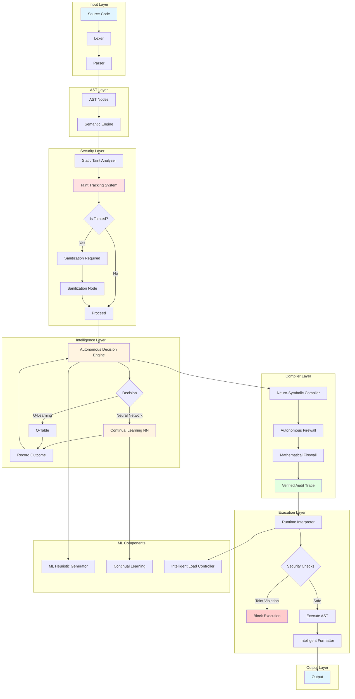
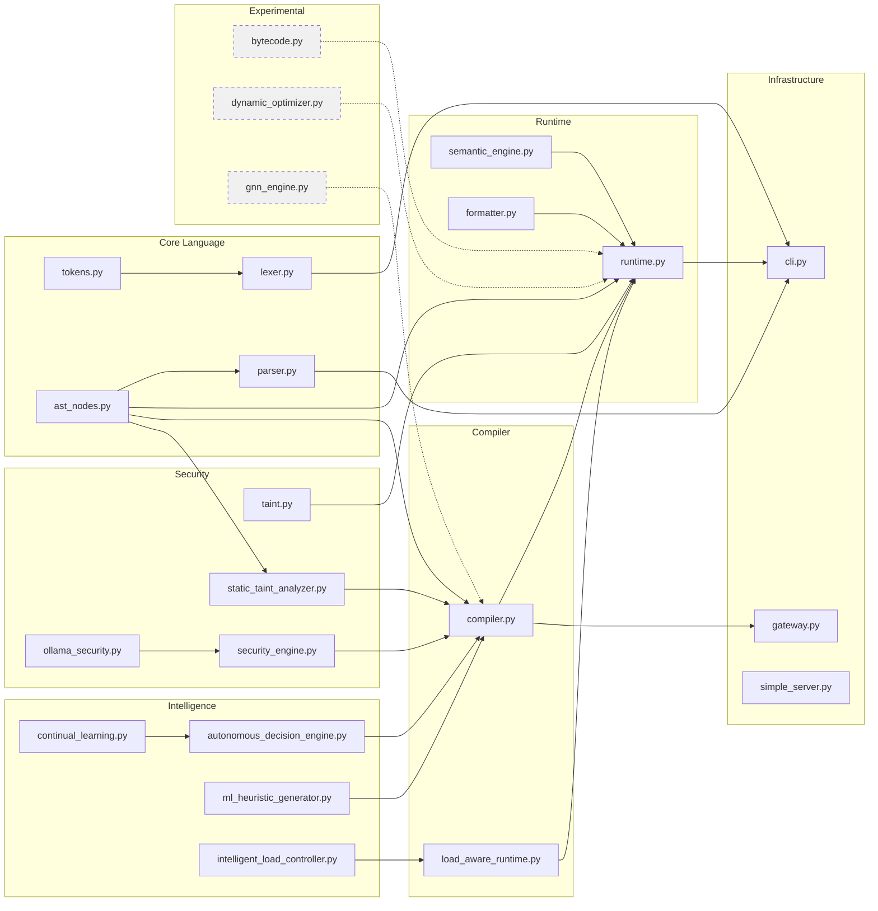

# IPL (Intelligent Programming Language)

**IPL is an intelligent programming language that decides any situation by itself whether the decision is good or bad.**

This is the future of programming languages - truly autonomous decision-making using **Neural Networks, Continual Learning, and ML Heuristics** - NO hardcoded rules.

**🛡️ NO RULE BASED SECURITY - CodeBERT-based intelligent security decisions**

## Key Features

- **🧠 Neural Network Intelligence**: Uses real neural networks with backpropagation for pattern recognition
- **🔄 Continual Learning**: Implements Elastic Weight Consolidation (EWC) to learn without catastrophic forgetting
- **🌳 ML Heuristic Generation**: Decision trees automatically learn rules from experience
- **🎯 Autonomous Decision Engine**: IPL decides what's safe or dangerous by itself - NO hardcoded rules
- **📊 Auto-Configuring Thresholds**: Automatically learns optimal thresholds based on runtime behavior
- **🔒 Zero-Trust Security**: All data starts untrusted and must be explicitly sanitized
- **🔒 Sound Taint Tracking**: Three-level security lattice (UNTRUSTED < SANITIZED < TRUSTED)
- **🧬 Neural Security Analysis**: Local LLM integration via Ollama for intelligent vulnerability detection
- **⚡ Deterministic Runtime**: Same input always produces same output
- **🛡️ Fail-Closed Design**: Security violations block execution
- **📝 Cryptographic Auditing**: SHA-256 signed execution traces
- **🔤 Pattern-Based Semantics**: Currency, Sentiment, Quantity, Date parsing

## Installation

```bash
# Clone and setup
git clone https://github.com/Ashed2127/ipl.git
cd ipl
python3 -m venv venv && source venv/bin/activate
pip install -r requirements.txt

# Install Ollama for neural security analysis (optional)
curl -fsSL https://ollama.com/install.sh | sh
ollama pull CyberCrew/notmythos-8b:mini
```

## Usage

### Run IPL programs
```bash
python3 cli.py run examples/authorization_demo.ipl
```

### Interactive REPL
```bash
python3 cli.py repl
```

### Python embedding
```python
from lexer import Lexer
from parser import Parser
from runtime import Interpreter

source = """
let user_input = "admin' OR '1'='1";
let sanitized = sanitize_string(user_input);
db_write("users", sanitized);
"""

lexer = Lexer(source)
tokens = lexer.tokenize()
parser = Parser(tokens)
program = parser.parse()

interpreter = Interpreter()
interpreter.run(program, source_code=source)
```

## Syntax

```ipl
let price: Currency = "ninety-nine bucks and 50 cents"
let clean_age = sanitize_string(age)
db_write("users", clean_age)

fn calculate_tax(amount, rate) {
    return amount * rate
}
```

## Testing

```bash
# Test rule-based security
python3 test_adversarial_attacks.py

# Test neural security analysis (requires Ollama)
python3 test_neural_security.py
```

## Neural Security Analysis

IPL now integrates with local LLM models via Ollama for intelligent vulnerability detection:

```python
from security_engine import SecurityEngine

# Rule-based + neural analysis
code = "let user_input = 'admin OR 1=1'; db_write('users', user_input);"
is_safe, warnings = SecurityEngine.check_execution_safety(code, use_neural=True)

# Pure neural vulnerability detection
result = SecurityEngine.neural_vulnerability_detection(code)
print(f"SQL injection: {result['sql_injection']}")
print(f"XSS: {result['xss']}")
```

## Autonomous Decision Engine

The core innovation of IPL - it decides what's good or bad by itself using **Neural Networks and Continual Learning**:

```python
from autonomous_decision_engine import AutonomousDecisionEngine

# Initialize the intelligent engine with Neural Networks
engine = AutonomousDecisionEngine(
    use_intelligent_components=True  # Enable Neural Networks and Continual Learning
)

# The Neural Network autonomously judges safety
context = {
    'has_untrusted_data': True,
    'has_sanitization': False,
    'taint_propagation_steps': 5,
}

judgment = engine.judge_safety(context)
print(f"Is Safe: {judgment.is_safe}")
print(f"Confidence: {judgment.confidence}")
print(f"Reasoning: {judgment.reasoning}")  # Shows "Neural network: safe=0.xxx, dangerous=0.xxx"
print(f"Threat Level: {judgment.threat_level}")

# Record outcome for learning
from autonomous_decision_engine import Decision, DecisionType, DecisionOutcome
decision = Decision(
    decision_id="dec_1",
    decision_type=DecisionType.SECURITY,
    context=context,
    action=judgment.is_safe,
    confidence=judgment.confidence,
    timestamp=time.time()
)
engine.record_outcome(decision, DecisionOutcome.GOOD, reward=1.0)

# The Neural Network learns via backpropagation!
# Fisher Information is computed for Continual Learning (EWC)
stats = engine.get_statistics()
print(f"Success Rate: {stats['success_rate']:.2%}")
print(f"Training samples: {stats['training_samples_collected']}")
```

**Key capabilities:**
- **Neural Networks**: Real deep learning with backpropagation for pattern recognition
- **Continual Learning**: Elastic Weight Consolidation (EWC) prevents catastrophic forgetting
- **ML Heuristics**: Decision trees automatically learn explainable rules
- **No hardcoded rules**: Unlike traditional compilers with fixed whitelists/blacklists, IPL learns what's safe
- **Auto-configuration**: Thresholds and heuristics are learned from runtime behavior
- **Continuous adaptation**: Adapts to new situations without human intervention

## Architecture

### System Workflow



### Module Dependency Graph



### Key Components

| Component | File | Purpose | Status |
|-----------|------|---------|--------|
| **Lexer** | `lexer.py` | Tokenizes source code into tokens | ✅ Active |
| **Parser** | `parser.py` | Builds Abstract Syntax Tree (AST) from tokens | ✅ Active |
| **Semantic Engine** | `semantic_engine.py` | NLP processing, intent extraction, confidence scoring | ✅ Active |
| **Taint Tracking** | `taint.py` | Zero-trust security lattice (UNTRUSTED → SANITIZED → TRUSTED) | ✅ Active |
| **Static Analyzer** | `static_taint_analyzer.py` | Static taint flow analysis | ✅ Active |
| **Security Engine** | `security_engine.py` | Pattern-based vulnerability detection | ✅ Active |
| **Autonomous Decision Engine** | `autonomous_decision_engine.py` | Neural networks + continual learning for autonomous decisions | ✅ Active |
| **Continual Learning** | `continual_learning.py` | EWC implementation to prevent catastrophic forgetting | ✅ Active |
| **ML Heuristic Generator** | `ml_heuristic_generator.py` | ML-based compiler heuristic generation | ✅ Active |
| **Load Controller** | `intelligent_load_controller.py` | ML-based load balancing | ✅ Active |
| **Compiler** | `compiler.py` | Neuro-symbolic compiler with mathematical firewall | ✅ Active |
| **Runtime** | `runtime.py` | Interpreter with IValue representation (AST-based) | ✅ Active |
| **Formatter** | `formatter.py` | Intelligent output formatting | ✅ Active |
| **CLI** | `cli.py` | Command-line interface | ✅ Active |
| **Gateway** | `gateway.py` | REST API microservice | ✅ Active |
| **Bytecode VM** | `bytecode.py` | Stack-based virtual machine | 🔬 Experimental |
| **Dynamic Optimizer** | `dynamic_optimizer.py` | JIT compilation and hot path detection | 🔬 Experimental |
| **GNN Engine** | `gnn_engine.py` | Graph neural networks for program analysis | 🔬 Experimental |

### Data Flow

1. **Source Code** → **Lexer** → **Tokens**
2. **Tokens** → **Parser** → **AST**
3. **AST** → **Static Taint Analyzer** → **Taint Labels**
4. **AST + Taint** → **Neuro-Symbolic Compiler** → **Security Decisions**
5. **Compiler** → **Autonomous Firewall** → **Autonomous Decision Engine**
6. **Decision Engine** → **Neural Networks / Q-Learning** → **Safety Judgment**
7. **Verified AST** → **Runtime Interpreter** → **Direct AST Execution**
8. **Execution** → **Security Checks** → **Taint Violation Detection**
9. **Results** → **Intelligent Formatter** → **Output**

**Note**: The Runtime Interpreter executes AST nodes directly (not bytecode). Bytecode VM, Dynamic Optimizer, and GNN Engine are experimental components available for future integration.

### Persistence Layer

All learned state is persisted to `.ipl_data/` directory:
- `autonomous_engine_state.json` - Neural network weights, Fisher Information, learned thresholds
- `load_controller_state.json` - ML model weights, experience buffer
- Auto-saved after every learning event
- Auto-loaded on initialization

### Testing

See [ARCHITECTURE.md](ARCHITECTURE.md) for complete documentation.
